# Color Cavern 💎🗡️

🏆 **2nd position at the Techwiz 2024 Game Development Global Competition.**

A 3D adventure game made in **Unity**. Play as a hero through three levels, collect gems and diamonds before time runs out, avoid or defeat monsters, and unlock the treasure at the Red Castle.

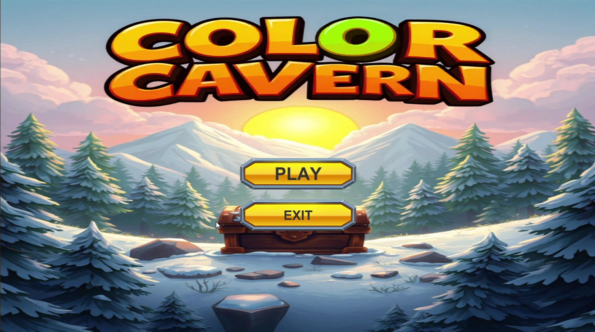

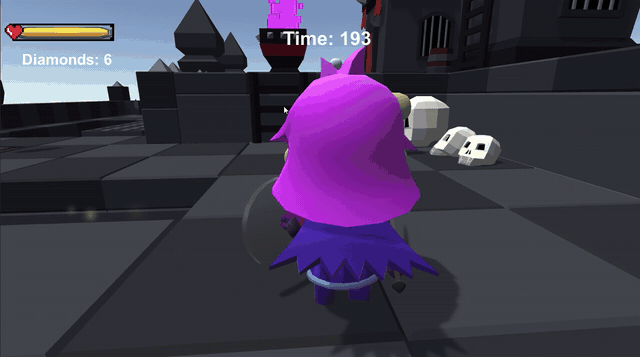

## Watch and play

- **Gameplay video:** [add your YouTube or Google Drive link here]
- **Download the game (Windows):** [Latest release](https://github.com/AbdulRafey05/color-cavern/releases/latest). Unzip it and run the `.exe` file. Windows may show a SmartScreen warning because the game is not code-signed. Click **More info**, then **Run anyway**.

## About the game

Color Cavern takes the player through three levels with different goals. On the way you collect gems, watch your health and the countdown timer, and face monsters that get harder in every level. The game has a main menu, a controls page, instruction pages for each level and a character selection screen where the player picks one of two heroes.

## Levels

| Level | Name | Goal |
|-------|------|------|
| 1 | Lush Jungle Adventure | Collect as many gems as you can before the time limit ends. Small monsters stand in the way but do not chase you. The level ends at the Red Castle, where the gems you collected unlock the treasure. |
| 2 | Icy Cavern | Find hidden diamonds while avoiding monsters that now follow you. Use tight spaces to lose them. |
| 3 | Fiery Lava Pits | Defeat the skeleton enemies and collect the diamonds before time runs out. After 15 diamonds, the red door of the castle opens and you win the game. |

## Controls

| Key | Action |
|-----|--------|
| W, A, S, D | Move forward, left, backward, right |
| Space | Jump |
| U | Climb ladders (stand near a ladder) |
| F | Attack with the sword |

The player script also supports on-screen buttons for moving and jumping.

## Features

- Three levels with different goals and growing difficulty
- Two playable heroes, chosen on the character selection screen
- Collect gems, coins and diamonds, with a live score or diamond counter
- Health bar and countdown timer, with Win and Game Over panels
- Sword attack with animation, jump and ladder climbing
- Speed boost pickup that doubles the player's speed for a few seconds
- Treasure chest and castle door that open when you collect enough gems or diamonds
- Skeleton enemies that patrol, chase and attack, and can be defeated with the sword
- Flying monsters that follow the player within a range and fly back to their start point
- Sound effects for jumping, attacking, taking damage, collecting, winning and losing, plus background music
- Main menu with Play and Exit buttons, a controls page and an instruction page before each level

## How it is built

All gameplay scripts are written in C# and live in `Assets/Script`.

| Script | What it does |
|--------|--------------|
| `PlayerMovement` | Movement, turning, jump, ladder climbing, sword attack, speed boost and animations |
| `HealthBar` | Player health and damage |
| `SkeletonEnemy` | Skeleton AI: idle, run towards the player, attack with a cooldown, take damage and die |
| `Skeleton` | Patrol and chase behaviour with detection and attack ranges |
| `FlyMonster` | Flying enemy that follows the player in range, attacks with a cooldown and returns to its start |
| `DiamondCollection` | Counts diamonds, opens the castle door and shows the win panel |
| `CoinCollector`, `CoinsCollection2` | Count coins or gems, open the treasure chest and show the win panel |
| `GameManager` | Countdown timer and the Game Over panel |
| `AudioManager` | Background music and sound effects |
| `MainMenuController` | Button handling and scene loading |
| `PlayerSelection` | Saves the chosen hero with `PlayerPrefs` and loads Level 1 |

### Scene flow

`Main Menu` → `button instruction` (controls) → `Level one instruction 1` → `PlayerSElection` → `Level 1` → `Level 2 instruction` → `Level 2` → `Level 3 instruction 1` → `LEVEL3`

All scenes are in `Assets/LEVELS`.

## Screenshots

### Menus and instructions

| Controls | Character selection |
|:-:|:-:|
| 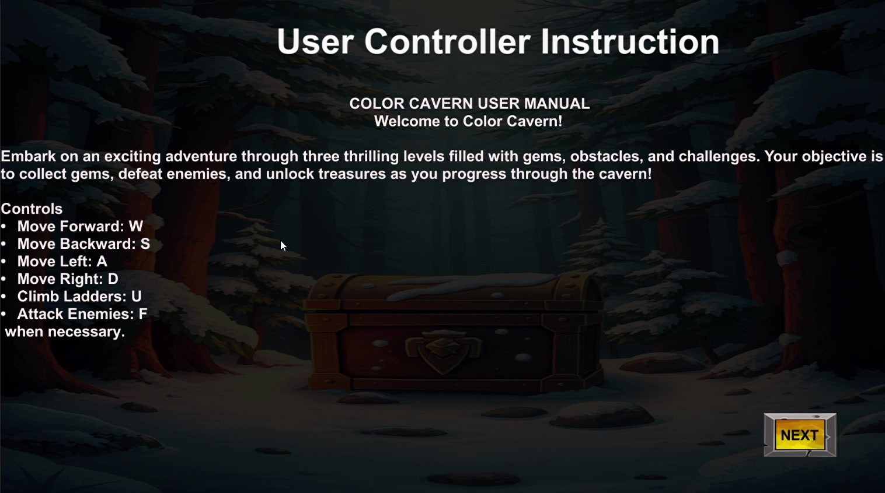 | 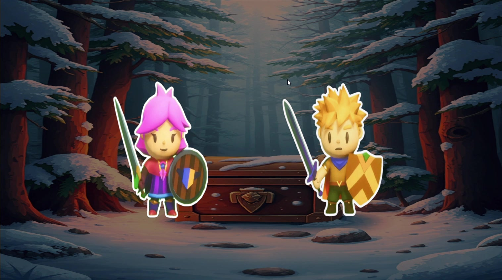 |
| 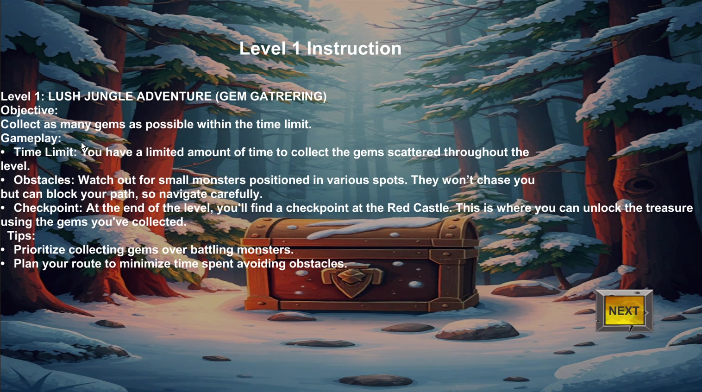 | 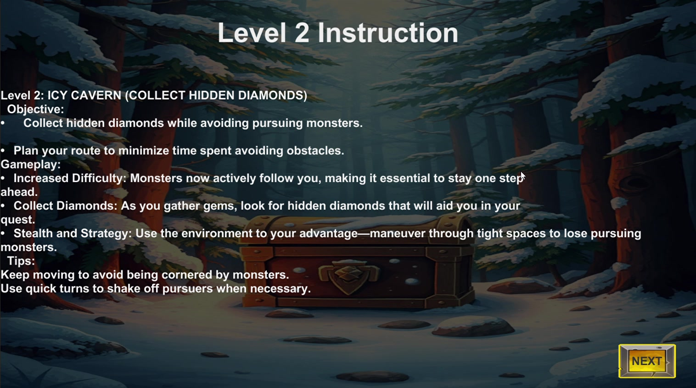 |
| 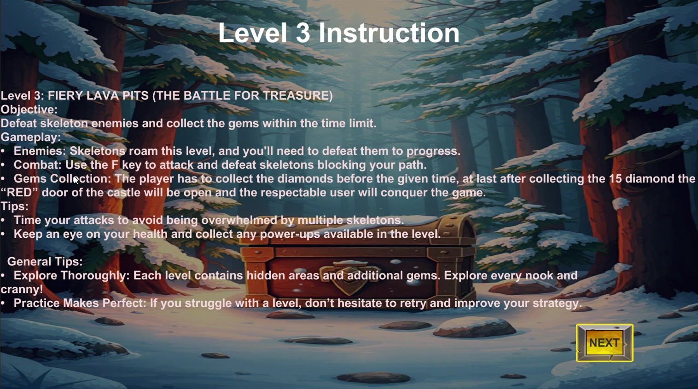 | |

### Level 1: Lush Jungle Adventure

| | |
|:-:|:-:|
| 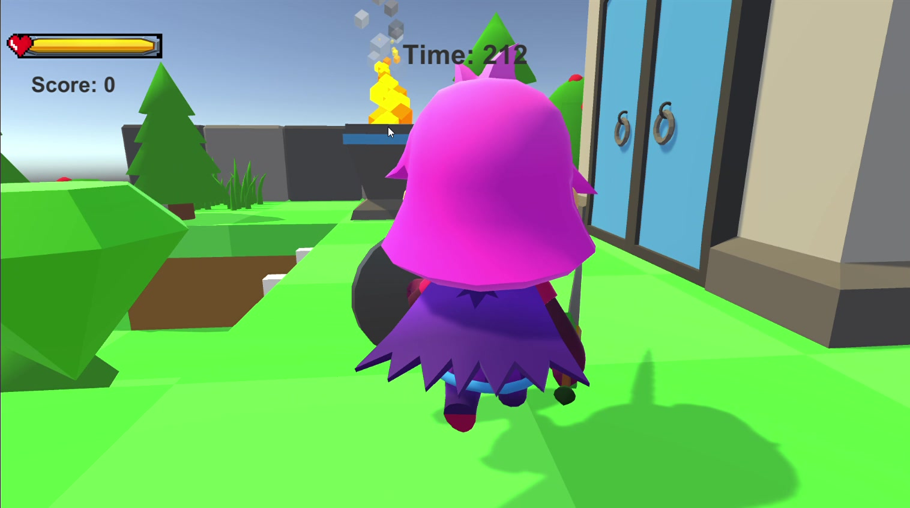 | 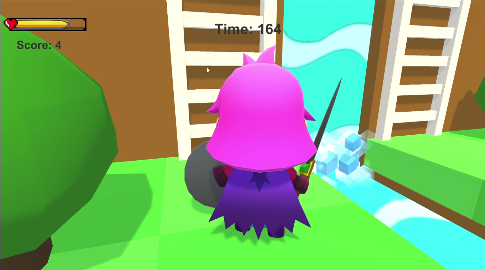 |
| 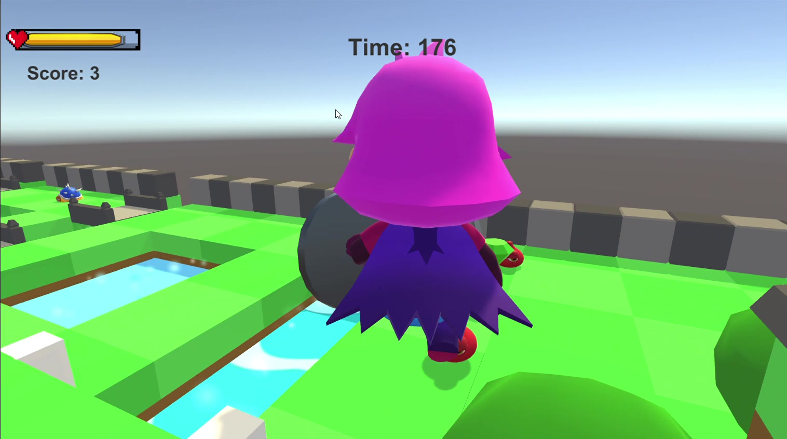 | |

### Level 2: Icy Cavern

| | |
|:-:|:-:|
| 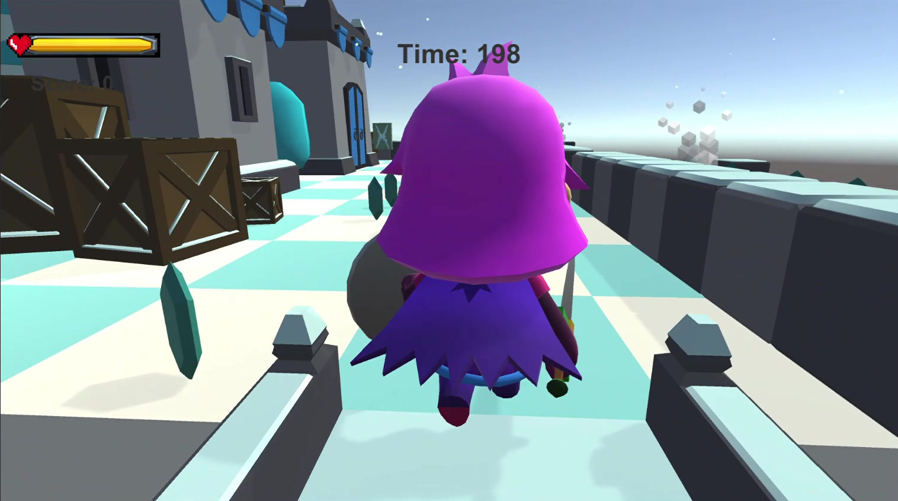 | 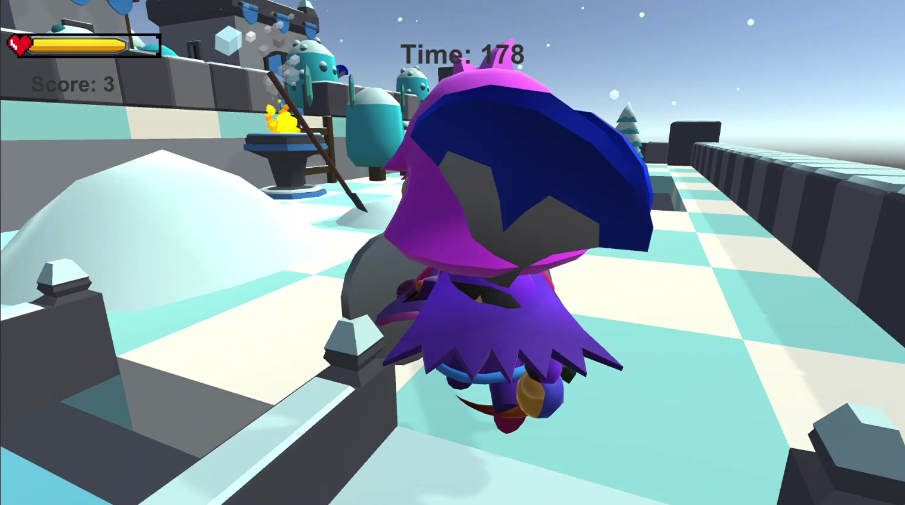 |
| 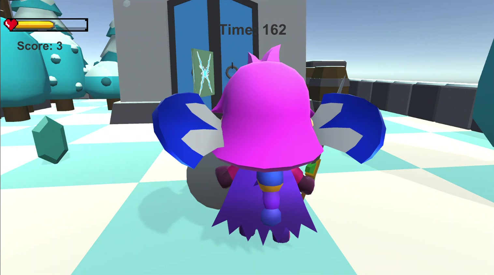 | |

### Level 3: Fiery Lava Pits

| | |
|:-:|:-:|
| 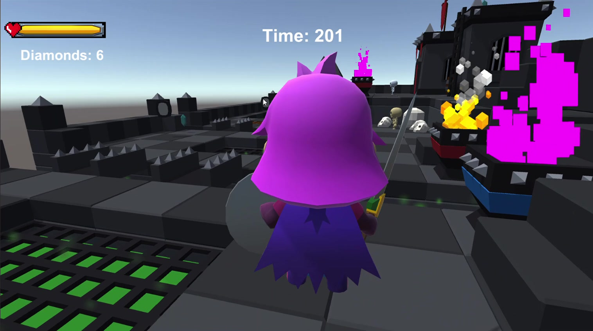 | 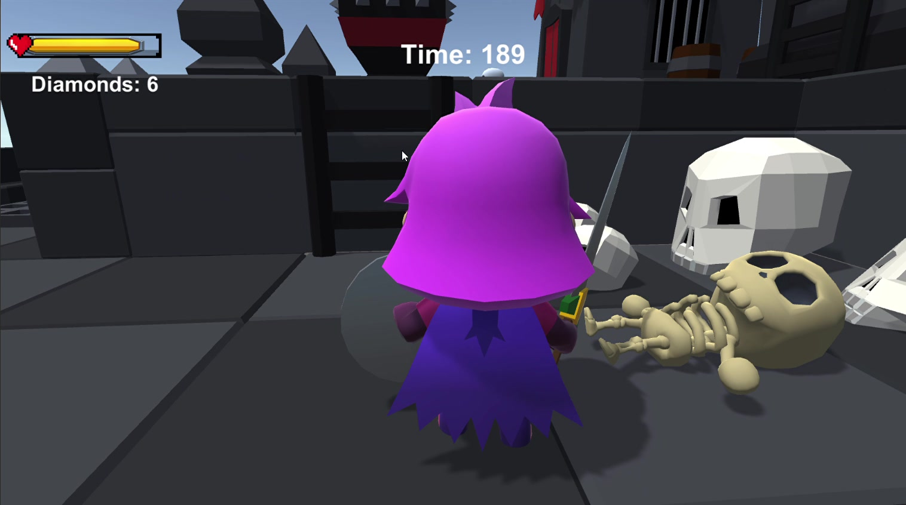 |

## Tech

| Area | Tools |
|------|-------|
| Game engine | Unity 2022.3.46f1 |
| Language | C# |
| Editor | Visual Studio |

## How to open the project

1. Install [Unity Hub](https://unity.com/download) and the Unity editor version **2022.3.46f1**.
2. Clone this repository:
   ```bash
   git clone https://github.com/AbdulRafey05/color-cavern.git
   ```
3. In Unity Hub click **Add**, choose the cloned folder and open it. The first open takes a few minutes while Unity rebuilds its `Library` folder.
4. Open `Assets/LEVELS/Main Menu.unity` and press **Play**.

## Project structure

```
color-cavern/
├── Assets/
│   ├── LEVELS/        # All game scenes (menu, instructions, character selection, levels 1 to 3)
│   ├── Script/        # C# gameplay scripts
│   ├── All prefabs/   # Prefabs such as the player, diamonds, gems, audio manager and canvases
│   └── ...            # Third-party art, models, audio and UI packs
├── Packages/          # Unity package list
├── ProjectSettings/   # Unity project settings
├── docs/              # Screenshots and gameplay GIF used in this README
├── .gitignore         # Ignores Unity's generated folders
├── LICENSE
└── README.md
```

## Credits

This project uses third-party assets from the Unity Asset Store and other sources. The asset folders in the project are:

- AurynSky: Dungeon Pack, Forest Pack, Gems Ultimate Pack and WinterArena
- DoubleL
- Leohpaz
- Mini Simple Characters Skeleton Demo
- Monster Minion Survivor PBR Polyart
- RPG Monster DUO PBR Polyart
- RPG Tiny Hero Duo
- SimpleCollectiblesPack
- Health-Bar-master
- xDeviruchi (music)
- [UIFabrica] TrollNest Free (UI)

Thanks to the creators of these assets. Each asset keeps its own license.

## Author

**Muhammad Abdul Rafey Yashir**
BS Artificial Intelligence student, Karachi, Pakistan
- LinkedIn: [abdulrafeyyashir](https://www.linkedin.com/in/abdulrafeyyashir)
- Email: arafeyyashir@gmail.com
- Portfolio: [abdulrafey05.github.io/Portfolio](https://abdulrafey05.github.io/Portfolio/)

## License

The code in this project is licensed under the MIT License. See the [LICENSE](LICENSE) file. Third-party assets keep their own licenses.
